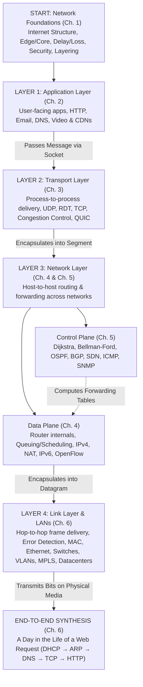
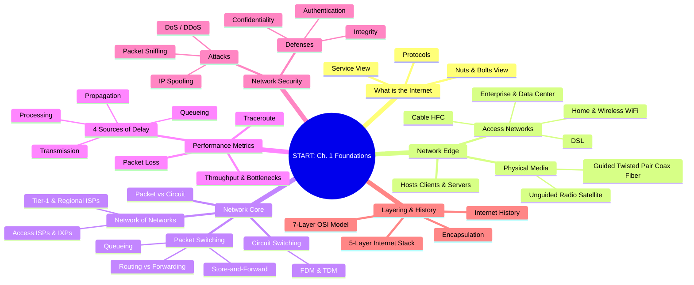
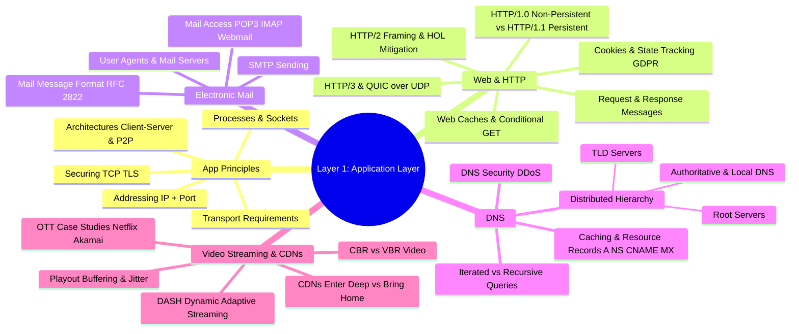
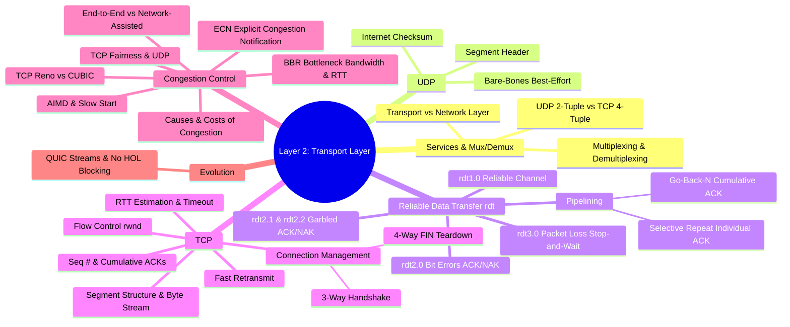
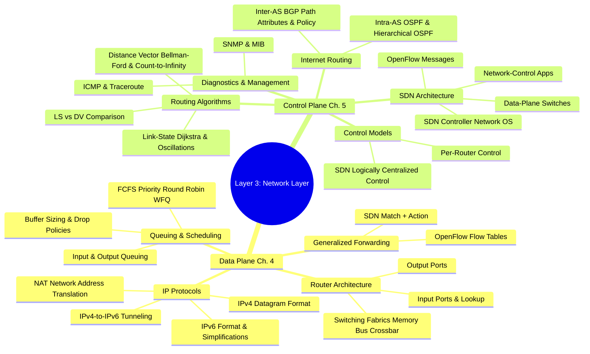
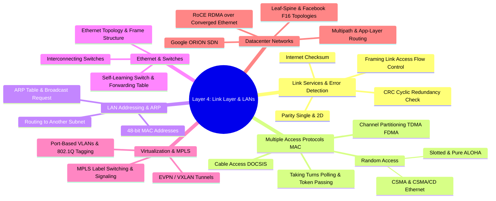

# Computer Networks: Complete 4-Layer Mind Map & Topic Flow

A complete, end-to-end mind map and topic breakdown covering **Chapters 1–6** (`Chapter_1_v9.0` through `Chapter_6_v9.0`). The flow begins at the **Foundation (Chapter 1)**, branches into the **4 Core Protocol Layers (Chapters 2–6)**, and concludes with the **End-to-End Web Request Synthesis**.

---

## High-Level Flow: From Start to the 4 Layers

---

## START: Network Foundations & Reference Models (Chapter 1)

Before diving into the 4 layers, Chapter 1 establishes what the Internet is, how data moves through it, what slows it down, how it is attacked/defended, and why it is organized into layers.

### Mind Map Flow (Chapter 1)

### Topics & Simple Explanations (Chapter 1)

| Topic | Subtopics | Simple Explanation of What It Does |
| :--- | :--- | :--- |
| **What is the Internet?** | Nuts-and-bolts view, Service view, Protocols | Defines the Internet both as physical hardware (hosts, routers, links, ISPs) and as an infrastructure providing communication services to apps, governed by **protocols** (rules for message format, order, and actions). |
| **Network Edge** | Hosts (clients & servers), Access networks (Cable, DSL, Home, Wireless/WiFi, Enterprise, Data Center), Physical media (Twisted pair, Coax, Fiber, Wireless radio) | Connects end-user devices to the first router using wired or wireless access links and transmits bits across physical media. |
| **Network Core** | Packet switching (store-and-forward, queueing), Routing vs. Forwarding, Circuit switching (FDM, TDM), Network of networks (Tier-1, Regional, Access ISPs, IXPs) | Moves data through a mesh of interconnected routers. **Packet switching** shares links dynamically in small chunks; **circuit switching** reserves dedicated end-to-end resources (via frequency or time slots). **Routing** finds the path; **forwarding** moves packets from input to output port. |
| **Delay, Loss & Throughput** | Nodal processing (`d_proc`), Queueing (`d_queue`), Transmission (`L/R`), Propagation (`d/s`), Packet loss, End-to-end throughput, Traceroute | Explains why data slows down or drops: packets wait in finite router buffers (causing queueing delay or loss when full), and overall transfer speed is capped by the slowest **bottleneck link**. `traceroute` measures real-world hop delays. |
| **Network Security** | Packet sniffing, IP spoofing, Denial of Service (DoS/DDoS), Lines of defense (authentication, confidentiality, integrity) | Identifies how attackers intercept traffic, fake source addresses, or flood servers, and how networks verify identity and protect data. |
| **Protocol Layers & Models** | 5-layer Internet stack (Application, Transport, Network, Link, Physical), 7-layer OSI model (adds Presentation & Session), Encapsulation | Breaks complex networking into modular layers where each layer wraps the upper layer's data in its own header (**encapsulation**: message → segment → datagram → frame). |
| **Internet History & Tools** | ARPAnet, ALOHAnet, TCP/IP (1983), Web, Broadband/SDN, Wireshark | Traces how packet switching evolved into the modern Internet and introduces **Wireshark** for capturing and inspecting live network packets. |

---

## LAYER 1: Application Layer (Chapter 2)

The Application Layer is where user-facing network software runs and communicates across hosts via sockets.

### Mind Map Flow (Layer 1)

### Topics & Simple Explanations (Layer 1)

| Topic | Subtopics | Simple Explanation of What It Does |
| :--- | :--- | :--- |
| **Principles of Network Apps** | Client-Server vs. P2P, Processes & Sockets, IP + Port Addressing, App Transport Needs (loss, throughput, timing, security), TCP vs. UDP services, TLS | Explains how programs on different hosts talk through **sockets** (software doors) identified by an IP address and port number, and how apps choose between reliable **TCP** (plus **TLS** encryption) or fast **UDP**. |
| **Web & HTTP** | Non-persistent vs. Persistent HTTP (1.1), Request/Response formats, Methods (`GET`, `POST`), Status codes (`200`, `404`, etc.) | Transfers web pages and objects between browsers and servers; **persistent HTTP** reuses one TCP connection for multiple objects to save round-trip times (RTTs). |
| **Cookies & State** | Cookie header, Set-cookie, User-server state, First-party vs. Third-party tracking, GDPR | Lets stateless HTTP servers remember users (logins, shopping carts, tracking) by storing a small ID in the browser. |
| **Web Caches & Conditional GET** | Proxy servers, Access link utilization, `If-Modified-Since` / `304 Not Modified` | Stores copies of web objects closer to the user (or in the browser) to cut response times and reduce external bandwidth usage, checking with **Conditional GET** so stale files aren't served. |
| **HTTP/2 & HTTP/3 (QUIC)** | HTTP/2 framing & interleaving, HOL blocking mitigation, HTTP/3 over QUIC (UDP, 0-RTT/1-RTT, built-in TLS, streams) | **HTTP/2** splits objects into interleaved frames so large files don't block small ones; **HTTP/3** replaces TCP with **QUIC** over UDP to eliminate TCP's head-of-line blocking and combine transport + TLS handshakes. |
| **Electronic Mail** | User agents, Mail servers, SMTP (port 25, 7-bit ASCII, push), RFC 2822 format, POP3, IMAP, Webmail (HTTP) | **SMTP** pushes outgoing mail between servers; **IMAP** (syncs folders on server), **POP3** (downloads locally), and **HTTP webmail** let recipients retrieve and read their messages. |
| **DNS (Domain Name System)** | Distributed hierarchy (Root, TLD, Authoritative, Local DNS), Iterated vs. Recursive queries, DNS caching, Resource Records (`A`, `NS`, `CNAME`, `MX`), DNS message format, Registration, DNS DDoS | Translates human-friendly domain names (like `www.amazon.com`) into IP addresses using a global, cached, hierarchical database rather than a single server. |
| **Video Streaming & CDNs** | CBR vs. VBR, Continuous playout & jitter buffering, DASH, Content Distribution Networks (CDNs: Enter Deep vs. Bring Home), Netflix OpenConnect & Akamai | Delivers smooth video over varying network speeds: **DASH** lets the client switch video quality chunk-by-chunk, while **CDNs** place content replicas near users to avoid congested core links. |

---

## LAYER 2: Transport Layer (Chapter 3)

The Transport Layer provides logical **process-to-process** communication between applications running on different hosts.

### Mind Map Flow (Layer 2)

### Topics & Simple Explanations (Layer 2)

| Topic | Subtopics | Simple Explanation of What It Does |
| :--- | :--- | :--- |
| **Transport Services & Mux/Demux** | Logical process communication, Multiplexing, Connectionless demux (UDP 2-tuple), Connection-oriented demux (TCP 4-tuple) | Packages app messages with port headers (**multiplexing**) and delivers incoming segments to the exact right app socket (**demultiplexing**) using destination port (UDP) or 4-tuple source/dest IP & port (TCP). |
| **UDP (User Datagram Protocol)** | No-frills best-effort service, 8-byte header, Internet checksum | Sends lightweight datagrams with no connection setup or reliability guarantees—ideal for loss-tolerant, delay-sensitive apps (DNS, streaming, SNMP). Uses a **checksum** to detect bit flips. |
| **Reliable Data Transfer (`rdt`)** | `rdt1.0` (perfect), `rdt2.0` (checksum + ACK/NAK), `rdt2.1`/`2.2` (seq #s for garbled ACKs), `rdt3.0` (timers for packet loss, stop-and-wait) | Step-by-step design showing how to build 100% reliable delivery over an unreliable channel using checksums, sequence numbers, acknowledgments, and retransmission timers. |
| **Pipelined Reliability** | Utilization math, Go-Back-N (GBN), Selective Repeat (SR), Window size vs. sequence space | Allows multiple unacknowledged packets in flight at once to keep the link busy. **GBN** resends everything from a lost packet onward; **SR** buffers out-of-order packets and resends only the lost ones. |
| **TCP Basics & Reliability** | Byte-stream numbering, Segment header, RTT estimation (EWMA + DevRTT), Timeout interval, Cumulative ACKs, Fast Retransmit (3 duplicate ACKs) | Provides a reliable, ordered byte stream over IP. Dynamically tunes its timeout to network **RTT** and uses **Fast Retransmit** to resend lost segments before the timer even expires. |
| **TCP Flow Control & Connection Mgmt** | Receive window (`rwnd`), 2-way vs. 3-way handshake (`SYN`, `SYNACK`, `ACK`), 4-way teardown (`FIN`) | **Flow control** prevents a fast sender from overflowing a slow receiver's buffer (`rwnd`). The **3-way handshake** safely opens connections and agrees on initial sequence numbers; **FIN** closes both directions cleanly. |
| **Congestion Control Principles** | Causes/costs of congestion (3 scenarios), End-to-end vs. Network-assisted | Explains how too much traffic fills router buffers, increases delay, and wastes upstream bandwidth on dropped packets, and contrasts inferring loss vs. getting router feedback. |
| **TCP Congestion Control** | AIMD (Additive Increase Multiplicative Decrease), Slow Start (exponential), Congestion Avoidance (linear), TCP Reno, TCP CUBIC, BBR ("just full enough"), ECN, TCP Fairness | Dynamically adjusts the sender's congestion window (`cwnd`) to probe for bandwidth without overloading the network: **Slow Start** ramps up fast, **AIMD/Reno** halves on loss, **CUBIC** uses a cubic curve for high-speed links, **BBR** paces at bottleneck bandwidth without filling buffers, and **ECN** lets routers warn before dropping packets. |
| **Transport Evolution (QUIC)** | Multiplexed streams, No HOL blocking, Integrated TLS | Runs over UDP to give HTTP/3 independent streams—if one stream loses a packet, other streams keep moving without stalling. |

---

## LAYER 3: Network Layer — Data Plane & Control Plane (Chapters 4 & 5)

The Network Layer moves packets **host-to-host** across interconnected networks. It is split into two cooperating planes: the **Data Plane (Chapter 4)** (per-router fast forwarding) and the **Control Plane (Chapter 5)** (network-wide routing and management).

### Mind Map Flow (Layer 3)

### Topics & Simple Explanations (Layer 3 — Data Plane, Chapter 4)

| Topic | Subtopics | Simple Explanation of What It Does |
| :--- | :--- | :--- |
| **Data vs. Control Plane** | Local forwarding vs. network-wide routing | Separates the fast per-router job of moving an arriving packet to an output link (**Data Plane**) from the slower job of computing the routes (**Control Plane**). |
| **Router Architecture** | Input ports (line termination, link layer, lookup), Switching fabrics (Memory, Shared Bus, Crossbar/Clos), Output ports | Hardware pipeline inside a router that looks up where a packet goes and physically transfers it from an input port to the right output port. |
| **Queuing, Buffering & Scheduling** | Input port queuing, Output port queuing, RFC 3439 buffer sizing, Drop policies, FCFS, Priority, Round Robin (RR), Weighted Fair Queuing (WFQ) | Manages congestion inside the router: decides which packets to buffer or drop when queues fill, and **schedules** which queued packet gets transmitted next (e.g., strict priority or fair bandwidth sharing via **WFQ**). |
| **IPv4, NAT & IPv6** | IPv4 datagram format, NAT translation table, IPv6 128-bit format (no checksum, no fragmentation, no options), Tunneling & encapsulation | **IPv4** defines the classic packet header; **NAT** lets a whole local network share one public IPv4 address; **IPv6** expands addresses to 128 bits and streamlines router processing; **tunneling** wraps IPv6 packets inside IPv4 so both can coexist during transition. |
| **Generalized Forwarding & OpenFlow** | Flow definition, Match + Action paradigm, OpenFlow flow table entries | Replaces rigid destination-IP-only forwarding with flexible **Match + Action** rules across link, network, and transport headers (forward, drop, modify, or send to controller). |

### Topics & Simple Explanations (Layer 3 — Control Plane, Chapter 5)

| Topic | Subtopics | Simple Explanation of What It Does |
| :--- | :--- | :--- |
| **Per-Router vs. SDN Control** | Distributed per-router algorithms vs. Logically centralized SDN controller | Contrasts traditional routers (each running its own routing software) with **SDN**, where a remote controller computes and installs forwarding tables across all switches. |
| **Link-State Routing (Dijkstra)** | Global topology knowledge, Dijkstra's algorithm, `O(n²)` complexity, Route oscillations | Every node broadcasts its link costs to all others and runs **Dijkstra's algorithm** to compute the shortest-cost path tree to every destination. |
| **Distance Vector Routing (Bellman-Ford)** | Distributed iterative updates, Bellman-Ford equation, Good news travels fast / Bad news travels slow (count-to-infinity) | Routers only talk to direct neighbors, sharing their distance estimates and updating shortest paths iteratively without needing the full network map. |
| **Intra-AS & Inter-AS Routing** | Autonomous Systems (AS), OSPF (open, Link-State, Hierarchical OSPF), BGP (eBGP/iBGP, `AS-PATH`, `NEXT-HOP`, policy-based route selection) | **OSPF** routes traffic *inside* a single organization's network (AS) using Link-State; **BGP** glues different ASes together across the global Internet using policy and path attributes. |
| **SDN Controller & OpenFlow** | Data-plane switches, SDN Controller (Network OS), Network-control apps, OpenFlow protocol (controller-to-switch & switch-to-controller messages) | Details the 3-layer **SDN** stack and how **OpenFlow** lets the central controller program switches, query stats, and handle unknown packets (`packet-in` / `flow-mod`). |
| **ICMP & Network Management** | ICMP messages, Traceroute via TTL/ICMP, Managing server, Managed devices, MIB, SNMP | **ICMP** reports network errors and powers `traceroute` (via TTL-exceeded replies); **SNMP** and **MIBs** let administrators monitor and configure thousands of network devices. |

---

## LAYER 4: Link Layer & Local Area Networks (Chapter 6)

The Link Layer transfers datagrams **hop-to-hop** across a single physical link between adjacent nodes (hosts, switches, routers).

### Mind Map Flow (Layer 4)

### Topics & Simple Explanations (Layer 4)

| Topic | Subtopics | Simple Explanation of What It Does |
| :--- | :--- | :--- |
| **Link Layer Services & Error Detection** | Framing, Link access, Flow control, Parity (1-bit & 2D), Internet checksum, Cyclic Redundancy Check (CRC) | Wraps network datagrams into **frames** and adds error-detection bits (**parity**, **checksum**, or powerful polynomial **CRC**) so the receiving node can catch corrupted bits. |
| **Multiple Access (MAC) Protocols** | Channel partitioning (TDMA, FDMA), Random access (Slotted ALOHA, Pure ALOHA, CSMA, CSMA/CD), Taking turns (Polling, Token Passing), DOCSIS | Coordinates how multiple nodes share one broadcast channel without colliding: **TDMA/FDMA** divide time/frequency; **ALOHA/CSMA/CD** transmit and recover from collisions; **Polling/Token** pass permission in turns; **DOCSIS** combines them for cable internet. |
| **MAC Addresses & ARP** | 48-bit IEEE MAC addresses, ARP table, ARP broadcast/reply, Subnet-to-subnet addressing walkthrough | **MAC addresses** permanently identify network interfaces on a local LAN; **ARP** maps a known IP address to its local MAC address so frames can reach the next hop or gateway router. |
| **Ethernet & Switches** | Bus vs. Star topology, Ethernet frame format, Self-learning switches, Forwarding tables, Multi-switch interconnection | **Ethernet** is the dominant wired LAN standard; **switches** isolate collision domains, allow simultaneous transmissions, and **self-learn** which MAC addresses sit behind which ports. |
| **VLANs & EVPN/VXLAN** | Traffic isolation, Port-based VLANs, 802.1Q tagged frames, Trunking, EVPN/VXLAN | Splits one physical switch infrastructure into multiple isolated virtual LANs (**802.1Q**) for security and broadcast control, and extends them across Layer 3 networks via **VXLAN** tunnels. |
| **MPLS (Multiprotocol Label Switching)** | Label-switched routers, Fixed-length labels, Traffic engineering, OSPF/IS-IS signaling | Forwards packets at high speed using short fixed-length **labels** rather than longest-prefix IP lookups, enabling explicit traffic-engineered paths. |
| **Datacenter Networks** | Server racks, Top-of-Rack (ToR) switches, Leaf/Spine & F16 topologies, Multipath, Load balancers, RoCE, Google ORION SDN | Connects tens of thousands of servers with redundant **leaf-spine** fabrics, multipath load balancing, ultra-low-latency **RoCE**, and SDN control (**ORION**). |

---

## END-TO-END SYNTHESIS: A Day in the Life of a Web Request (Chapter 6)

Chapter 6 ties **all 4 layers** together by tracing what happens when you plug in a laptop and request a web page (`www.google.com`):

1. **Connecting & Getting an IP (Link + Network + Transport + App):** Laptop broadcasts a **DHCP** request (over UDP → IP → Ethernet) to learn its IP address, subnet mask, first-hop router, and local DNS server.
2. **Finding the Gateway MAC (Link Layer):** Laptop uses **ARP** broadcast to find the MAC address of its first-hop router.
3. **Resolving the Domain Name (Application + Transport + Network + Link):** Laptop sends a **DNS** query (over UDP → IP → Ethernet) to its local DNS server to get `www.google.com`'s IP address.
4. **Opening the Connection (Transport Layer):** Laptop performs a **TCP 3-way handshake** (`SYN`, `SYNACK`, `ACK`) with the Google web server on port 80/443.
5. **Fetching the Web Page (Application Layer):** Laptop sends an **HTTP `GET`** request over the established TCP socket, and the server replies with the web page!
